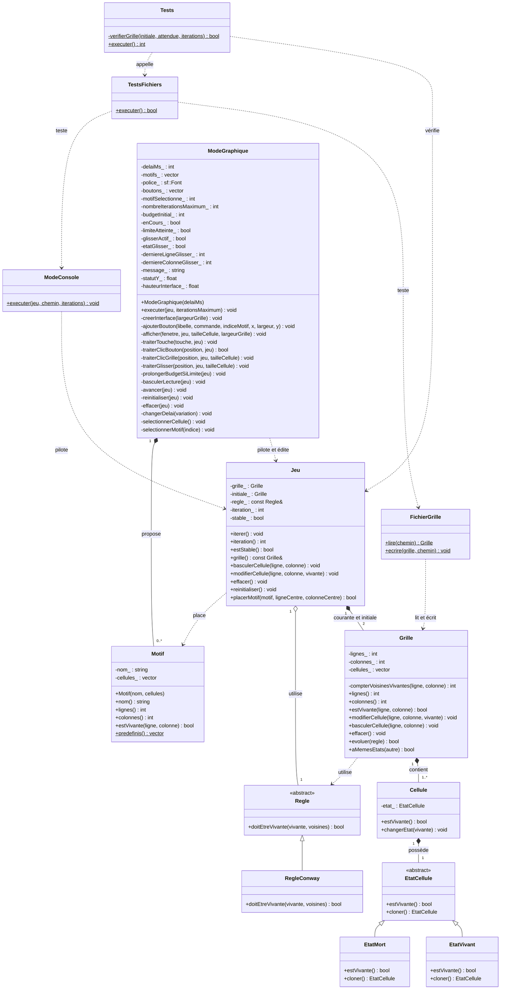
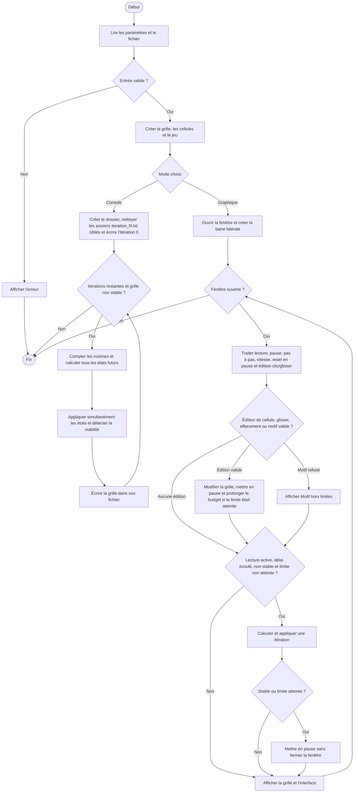
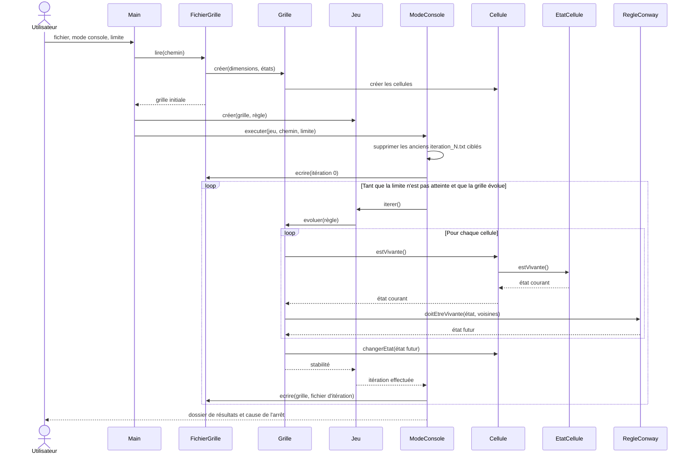

# Conception UML

## Diagramme de classes

Notes de cohérence :

- `Jeu::regle_` est une référence non propriétaire `const Regle&` ; la règle doit vivre au moins aussi longtemps que le `Jeu`.
- `ModeGraphique` mémorise le budget initial. Une édition réussie après la limite efface `limiteAtteinte_` et fixe `nombreIterationsMaximum_` à `iteration + budgetInitial_`, sans remettre le compteur à zéro.
- `R` réinitialise en pause ; Reset et Clear remettent `nombreIterationsMaximum_` à `budgetInitial_`.
- Le glisser gauche réutilise `etatGlisser_` et `Jeu::modifierCellule` ; le message `Motif hors limites` est porté par `message_`.
- La répétition automatique du clavier est désactivée sur la fenêtre SFML.
- `Motif::predefinis` fournit Planeur 3x3, Clignotant 3x3, Bloc 2x2 et Crapaud 2x4.
- `ModeConsole::executer` supprime au préalable, dans le dossier de sortie, uniquement les fichiers réguliers nommés exactement `iteration_<chiffres>.txt` ; les autres fichiers et dossiers sont conservés.

## Diagramme d'activité

## Diagramme de séquence — une itération en mode console

