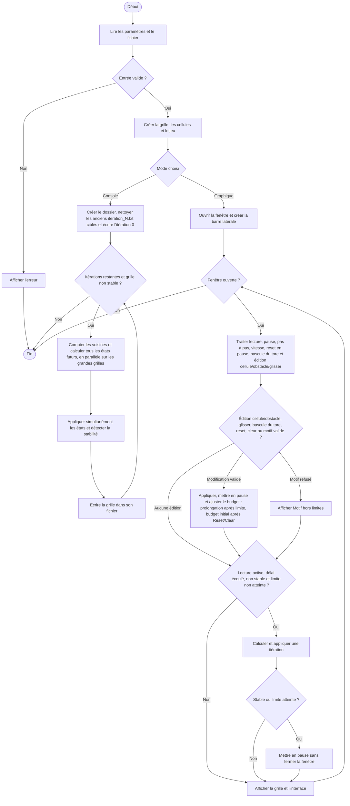

# Jeu de la vie — Conception UML

## Diagramme de classes

```mermaid
classDiagram
    class Jeu {
        -grille_ : Grille
        -initiale_ : Grille
        -regle_ : const Regle&
        -iteration_ : int
        -stable_ : bool
        +iterer() void
        +iteration() int
        +estStable() bool
        +grille() const Grille&
        +basculerCellule(ligne, colonne) void
        +modifierCellule(ligne, colonne, vivante) void
        +definirTorique(torique) void
        +basculerObstacle(ligne, colonne) void
        +effacer() void
        +reinitialiser() void
        +placerMotif(motif, ligneCentre, colonneCentre) bool
    }
    class Grille {
        -lignes_ : int
        -colonnes_ : int
        -torique_ : bool
        -cellules_ : vector
        -compterVoisinesVivantes(ligne, colonne) int
        -calculerEtatsSuivants(regle, debut, fin, prochainsEtats) void
        +lignes() int
        +colonnes() int
        +estVivante(ligne, colonne) bool
        +estObstacle(ligne, colonne) bool
        +estTorique() bool
        +definirTorique(torique) void
        +modifierCellule(ligne, colonne, vivante) void
        +basculerCellule(ligne, colonne) void
        +modifierObstacle(ligne, colonne, obstacle) void
        +basculerObstacle(ligne, colonne) void
        +effacer() void
        +evoluer(regle) bool
        +aMemesEtats(autre) bool
    }
    class Motif {
        -nom_ : string
        -cellules_ : vector
        +Motif(nom, cellules)
        +nom() string
        +lignes() int
        +colonnes() int
        +estVivante(ligne, colonne) bool
        +predefinis()$ vector
    }
    class Cellule {
        -etat_ : EtatCellule
        -obstacle_ : bool
        +estVivante() bool
        +changerEtat(vivante) void
        +estObstacle() bool
        +definirObstacle(obstacle) void
    }
    class EtatCellule {
        <<abstract>>
        +estVivante() bool
        +cloner() EtatCellule
    }
    class EtatVivant {
        +estVivante() bool
        +cloner() EtatCellule
    }
    class EtatMort {
        +estVivante() bool
        +cloner() EtatCellule
    }
    class Regle {
        <<abstract>>
        +doitEtreVivante(vivante, voisines) bool
    }
    class RegleConway {
        +doitEtreVivante(vivante, voisines) bool
    }
    class FichierGrille {
        +lire(chemin)$ Grille
        +ecrire(grille, chemin)$ void
    }
    class ModeConsole {
        +executer(jeu, chemin, iterations)$ void
    }
    class ModeGraphique {
        -delaiMs_ : int
        -motifs_ : vector
        -police_ : sf::Font
        -boutons_ : vector
        -cellules_ : sf::VertexArray
        -motifSelectionne_ : int
        -outilObstacle_ : bool
        -nombreIterationsMaximum_ : int
        -budgetInitial_ : int
        -enCours_ : bool
        -limiteAtteinte_ : bool
        -glisserActif_ : bool
        -etatGlisser_ : bool
        -derniereLigneGlisser_ : int
        -derniereColonneGlisser_ : int
        -message_ : string
        -dernierTitre_ : string
        -statutY_ : float
        -hauteurInterface_ : float
        +ModeGraphique(delaiMs)
        +executer(jeu, iterationsMaximum) void
        -creerInterface(largeurGrille) void
        -ajouterBouton(libelle, commande, indiceMotif, x, largeur, y) void
        -afficher(fenetre, jeu, largeurGrille) void
        -traiterTouche(touche, jeu) void
        -traiterClicBouton(position, jeu) bool
        -traiterClicGrille(position, jeu, tailleCellule) void
        -traiterGlisser(position, jeu, tailleCellule) void
        -prolongerBudgetSiLimite(jeu) void
        -basculerLecture(jeu) void
        -avancer(jeu) void
        -reinitialiser(jeu) void
        -effacer(jeu) void
        -changerDelai(variation) void
        -selectionnerCellule() void
        -selectionnerObstacle() void
        -selectionnerMotif(indice) void
        -basculerTorique(jeu) void
    }
    class Tests {
        -verifierGrille(initiale, attendue, iterations)$ bool
        +executer()$ int
    }
    class TestsFichiers {
        +executer()$ bool
    }
    class TestsExtensions {
        +executer()$ bool
    }

    Jeu "1" *-- "2" Grille : courante et initiale
    Jeu "1" o-- "1" Regle : utilise
    Jeu ..> Motif : place
    Grille "1" *-- "1..*" Cellule : contient
    Cellule "1" *-- "1" EtatCellule : possède
    EtatCellule <|-- EtatVivant
    EtatCellule <|-- EtatMort
    Regle <|-- RegleConway
    Grille ..> Regle : utilise
    FichierGrille ..> Grille : lit et écrit
    ModeConsole ..> Jeu : pilote
    ModeGraphique ..> Jeu : pilote et édite, tore et obstacles
    ModeGraphique "1" *-- "0..*" Motif : propose
    Tests ..> Jeu : vérifie
    Tests ..> TestsFichiers : appelle
    Tests ..> TestsExtensions : appelle
    TestsFichiers ..> FichierGrille : teste
    TestsFichiers ..> ModeConsole : teste
    TestsExtensions ..> Jeu : vérifie réinitialisation, stabilité et bascule du tore
    TestsExtensions ..> Grille : vérifie tore, obstacles, hors bornes, aMemesEtats et copie
```

Notes de cohérence :

- `Jeu::regle_` est une référence non propriétaire `const Regle&` ; la règle doit vivre au moins aussi longtemps que le `Jeu`.
- `ModeGraphique` mémorise le budget initial. Une modification réussie (cellule, glisser, obstacle, motif ou bascule du tore) met la simulation en pause et, après la limite, efface `limiteAtteinte_` et fixe `nombreIterationsMaximum_` à `iteration + budgetInitial_`, sans remettre le compteur à zéro.
- `R` réinitialise en pause et restaure le tore et les obstacles initiaux ; Reset et Clear remettent `nombreIterationsMaximum_` à `budgetInitial_`. Clear conserve le tore courant.
- La grille est non torique par défaut (`Grille::torique_ = false`). En mode torique, chaque voisin sortant est replié modulo `lignes_` et `colonnes_`, horizontalement, verticalement et dans les coins ; le mode console ne l'active jamais.
- `T` ou le bouton `Tore` bascule le tore ; `O` ou le bouton `Outil obstacle` sélectionne l'outil Obstacle. Un clic avec cet outil inverse `Cellule::obstacle_` sans changer son état vivant ou mort ; le glisser ne s'applique pas aux obstacles.
- `Grille::evoluer` conserve exactement l'état d'un obstacle et n'appelle pas `Regle::doitEtreVivante` pour lui. `compterVoisinesVivantes` s'appuie sur `estVivante` : un obstacle vivant compte donc comme voisine, un obstacle mort non.
- `Jeu::reinitialiser` restaure `initiale_`, donc le tore et les obstacles définis à la construction. `Jeu::effacer` tue les cellules et retire les obstacles via `Grille::effacer`, sans modifier `torique_`.
- Le format texte 0/1 ne mémorise ni tore ni obstacles. `FichierGrille::lire` produit une grille non torique sans obstacle ; le mode console reste donc non torique et sans obstacle.
- Les obstacles vivants sont dessinés en bleu et les obstacles morts en gris ; les cellules normales vivantes restent blanches et les mortes noires.
- `ModeGraphique::cellules_` est un `sf::VertexArray` de quads dont les positions sont précalculées à la création de l'interface ; à chaque image, seules les couleurs des sommets sont mises à jour et la grille est dessinée en un seul appel `draw`. `dernierTitre_` mémorise le dernier titre SFML : la fenêtre n'est réécrite que lorsque le texte change.
- `TestsFichiers::executer` couvre les allers-retours (dont matrices non carrées), les formats valides CRLF et sans saut de ligne final, ainsi que les rejets : fichier vide, en-tête partiel, dimensions nulles ou négatives, données en trop, valeur texte ou flottante.
- `TestsExtensions.h` est inclus et `TestsExtensions::executer` est appelé par `Tests::executer` de façon inconditionnelle ; il vérifie le tore (repli 3x3, tore 2x2 et multiplicités modulo, obstacle de bord torique), les obstacles figés mais comptés, les accès aux obstacles hors bornes sans modification, Reset/Clear, la double bascule du tore, le contrat de `aMemesEtats`, la copie indépendante des cellules et un planeur sur une grille 200x200 qui exerce le chemin des grandes grilles (parallèle si plusieurs cœurs sont disponibles).
- `Grille::evoluer` calcule la génération suivante en parallèle dès que la grille compte au moins 16 384 cellules et 16 lignes et que plusieurs cœurs sont disponibles, avec au plus 16 threads issus de `std::thread::hardware_concurrency`. Le tableau des états futurs est un `std::vector<unsigned char>` (et non `std::vector<bool>`) pour que chaque thread écrive une case mémoire distincte sans course de données. Les états courants ne sont modifiés qu'après le `join` de tous les threads. En dessous des seuils ou avec un seul cœur, le calcul reste séquentiel. `Regle::doitEtreVivante` peut donc être appelée concurremment : une implémentation doit être thread-safe et sans effet de bord.
- Le glisser gauche réutilise `etatGlisser_` et `Jeu::modifierCellule` ; le message `Motif hors limites` est porté par `message_`.
- La répétition automatique du clavier est désactivée sur la fenêtre SFML.
- `Motif::predefinis` fournit Planeur 3x3, Clignotant 3x3, Bloc 2x2 et Crapaud 2x4.
- `ModeConsole::executer` supprime au préalable, dans le dossier de sortie, uniquement les fichiers réguliers nommés exactement `iteration_<chiffres>.txt` ; les autres fichiers et dossiers sont conservés.

## Diagramme d'activité

## Diagramme de séquence — une itération en mode console (sans tore ni obstacle)

