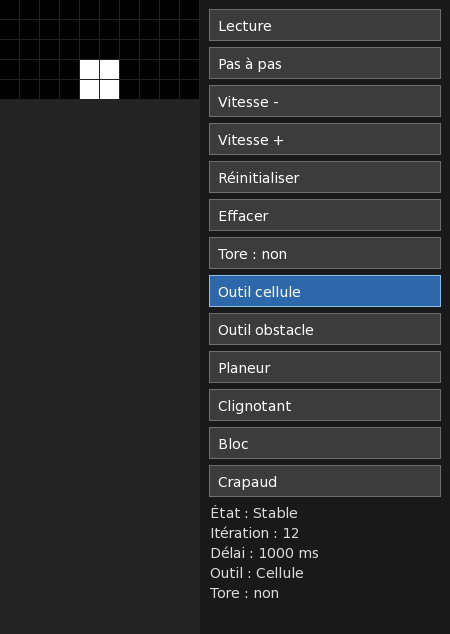

# Jeu de la vie


Implémentation C++17 du jeu de la vie de John Conway, avec un mode console et un mode graphique SFML.



## Fonctionnalités

- Modes console (écriture des itérations dans `<entrée>_out`) et graphique SFML interactif.
- Grille torique, cellules obstacles et quatre motifs prédéfinis plaçables.
- Calcul parallèle de la génération suivante sur les grandes grilles.
- Tests unitaires intégrés, exécutés par `make test`.

## Environnement et compilation

Récupérer le dépôt :

```bash
git clone https://github.com/VictorCESIVA/jeu-de-la-vie-poo.git
cd jeu-de-la-vie-poo
```

Sous Ubuntu 24.04, installer les outils nécessaires :

```bash
sudo apt-get install g++ make libsfml-dev fonts-dejavu-core
```

La police système **DejaVu Sans** est nécessaire au mode graphique ; elle est fournie par le paquet `fonts-dejavu-core`.

Puis, depuis ce dossier :

```bash
make
```

L'exécutable produit est `jeu_de_la_vie`. `./jeu_de_la_vie --help` affiche les options.

## Fichier d'entrée

La première ligne contient le nombre de lignes puis le nombre de colonnes. Les lignes suivantes contiennent uniquement des `0` (mort) et des `1` (vivant). Le fichier `exemple.txt` reprend l'exemple du sujet. Ce format ne mémorise que les états : le mode torique et les obstacles sont des réglages de session qui ne sont pas enregistrés ; un nouveau lancement à partir d'un fichier repart d'une grille non torique et sans obstacle.

## Mode console

```bash
./jeu_de_la_vie exemple.txt console 10
```

Le dernier argument est le nombre maximal d'itérations ; il vaut 100 par défaut. Les fichiers `iteration_0.txt`, `iteration_1.txt`, etc. sont écrits dans `exemple.txt_out`, dans le dossier courant. L'itération 0 conserve l'état initial. Avant d'écrire un nouveau run, le mode console supprime uniquement les fichiers nommés exactement `iteration_<chiffres>.txt` (par exemple `iteration_3.txt`) dans ce dossier ; les autres fichiers et dossiers sont conservés. Le programme s'arrête dès qu'une itération ne modifie plus aucune cellule, même si la limite n'est pas atteinte. Le mode console reste non torique et sans obstacle.

## Mode graphique

```bash
./jeu_de_la_vie exemple.txt graphique 100 500
```

Les arguments sont le délai initial entre deux itérations en millisecondes et le nombre maximal d'itérations. Leurs valeurs par défaut sont 100 ms et 1000 itérations. Le délai initial doit être au moins 10 ms ; une valeur inférieure est refusée au lancement. Les raccourcis `+` et `-` bornent ensuite le délai entre 10 et 2000 ms.

La barre latérale permet de contrôler la simulation et de choisir un outil d'édition :

| Action | Raccourci |
|---|---|
| Lecture / Pause | `Espace` |
| Pas à pas | `N` ou `flèche droite` |
| Vitesse `-` / `+` | `-` / `+` |
| Réinitialiser la grille initiale, tore et obstacles compris (en pause) | `R` |
| Effacer toutes les cellules et retirer les obstacles | `C` |
| Basculer la grille torique | `T` |
| Sélectionner l'outil Cellule | `0` |
| Sélectionner l'outil Obstacle | `O` |
| Sélectionner Planeur / Clignotant / Bloc / Crapaud | `1` / `2` / `3` / `4` |

`+` réduit le délai de 50 ms (minimum 10 ms) et `-` l'augmente de 50 ms (maximum 2000 ms). Avec l'outil **Cellule**, un clic gauche sur une case inverse son état et mémorise le nouvel état. En maintenant le bouton gauche et en glissant, ce même état est appliqué aux nouvelles cases traversées, sans jamais les rebasculer ; relâcher arrête le dessin et sortir de la grille n'applique rien. Avec un motif sélectionné, le clic place le motif en le centrant sur la case ; le placement est refusé sans modification si le motif ne tient pas entièrement dans la grille, et le message `Motif hors limites` apparaît alors dans la barre latérale. Ce message est effacé par la prochaine action réussie, un changement d'outil, un reset ou un clear. Toute édition met la simulation en pause.

La grille est **non torique par défaut**. Le bouton `Tore : non` / `Tore : oui` ou la touche `T` bascule le tore : chaque voisin sortant est alors replié modulo le nombre de lignes et de colonnes, horizontalement, verticalement et dans les coins. Avec l'outil **Obstacle** (`Outil obstacle` ou `O`), un clic gauche inverse le drapeau d'obstacle de la case sans modifier son état vivant ou mort ; cet outil ne se glisse pas. Pendant `evoluer`, un obstacle est figé : il garde exactement son état et la règle n'est pas appelée pour lui. Un obstacle vivant compte néanmoins comme une voisine vivante pour les autres cellules ; un obstacle mort ne compte pas.

Lorsque la limite d'itérations est atteinte, une modification réussie (cellule, glisser, obstacle, motif ou bascule du tore) met la simulation en pause, efface l'état de limite et accorde un nouveau budget d'itérations égal au budget initial, à partir de l'itération courante ; le compteur d'itérations n'est pas remis à zéro. Reset et Clear restaurent le budget initial. Reset restaure en outre le tore et les obstacles initiaux, c'est-à-dire tels qu'ils étaient à la construction du Jeu, tandis que Clear tue toutes les cellules et retire les obstacles sans changer le tore courant. La répétition automatique des touches est désactivée : maintenir une touche ne la répète pas. `R` restaure aussi la grille initiale en pause ; le lancement du mode graphique reste automatique. Le crapaud prédéfini est une forme 2x4.

Les cellules normales vivantes sont blanches et les cellules normales mortes noires ; les obstacles vivants sont bleus et les obstacles morts gris. L'état, l'itération, le délai, l'outil courant, le mode torique et l'éventuel message de placement sont affichés dans la barre latérale. Lorsque la grille devient stable ou que la limite d'itérations est atteinte, la simulation se met en pause mais la fenêtre reste ouverte. Fermer la fenêtre quitte le programme.

## Parallélisation

`Grille::evoluer` calcule la génération suivante en parallèle dès que la grille compte au moins 16 384 cellules et 16 lignes et que plusieurs cœurs sont disponibles, avec au plus 16 threads (`std::thread::hardware_concurrency`). En dessous de ces seuils ou avec un seul cœur, le calcul reste séquentiel pour éviter le coût de création des threads. Chaque thread traite une plage de lignes et écrit dans des indices distincts du tableau des états futurs ; les états courants ne sont modifiés qu'après la fin de tous les threads. Une implémentation de `Regle` doit donc être thread-safe et sans effet de bord.

## Tests unitaires intégrés

```bash
make test
```

Ou directement :

```bash
./jeu_de_la_vie --test
```

`Tests::verifierGrille` reçoit une grille initiale, une grille attendue et un nombre arbitraire d'itérations ; il s'arrête dès que la stabilité est détectée. Les scénarios métier vérifient un clignotant après une et deux itérations, ainsi que le scénario `le bloc reste stable lors d'une demande de cinq itérations`. Les tests de fichiers et de console sont regroupés dans `TestsFichiers::executer`, appelé par `Tests::executer` : ils couvrent les allers-retours lecture/écriture (dont matrices non carrées), les formats valides en CRLF ou sans saut de ligne final, le mode console, le nettoyage ciblé des anciens `iteration_N.txt` et la préservation des autres fichiers, ainsi que les rejets motivés : fichier vide, en-tête partiel, dimensions nulles ou négatives, données en trop, valeur texte ou flottante. `TestsExtensions` est intégré de façon inconditionnelle : son en-tête est inclus, son fichier source est compilé par le `Makefile` et `TestsExtensions::executer` est appelé par `Tests::executer` ; il couvre le repli torique horizontal, vertical et de coin, le tore 2x2 avec ses multiplicités modulo, les petites grilles 1x1 et 1xN, les obstacles figés mais comptés comme voisines, l'obstacle de bord torique, les accès aux obstacles hors bornes sans modification, la bascule d'obstacle et du tore, l'effacement, la réinitialisation, le contrat de `aMemesEtats`, la copie indépendante des états et obstacles, ainsi qu'un planeur sur une grille 200x200 qui exerce le chemin des grandes grilles (parallèle si plusieurs cœurs sont disponibles). Le programme renvoie 0 si tous les tests réussissent, sinon 1.

## Organisation du code

- `Jeu` contrôle les itérations, détecte la stabilité et gère les éditions, le tore, les obstacles, l'effacement et la réinitialisation.
- `Grille` compte les voisines (avec repli torique optionnel), applique simultanément les nouveaux états, gère les obstacles et parallélise le calcul des grandes générations.
- `Cellule` possède un `EtatCellule` polymorphe (`EtatVivant` ou `EtatMort`) et un drapeau d'obstacle copié avec la cellule.
- `Motif` représente une forme rectangulaire et fournit les quatre motifs prédéfinis.
- `RegleConway` applique les règles via l'interface abstraite `Regle`, indépendante des états.
- `FichierGrille` isole la lecture et l'écriture des fichiers ; le format texte ne contient que les états 0/1.
- `ModeConsole` et `ModeGraphique` utilisent le modèle sans modifier ses règles ; le mode graphique s'appuie sur SFML et propose l'édition interactive, la bascule du tore et l'outil Obstacle.
- `Tests` vérifie le modèle et appelle `TestsFichiers`, qui isole les tests de fichiers et de mode console, ainsi que `TestsExtensions`.
- `TestsExtensions` vérifie le tore, les obstacles, leur réinitialisation, la copie indépendante des cellules et une grande grille parallèle.

Les diagrammes demandés se trouvent dans [CONCEPTION.md](CONCEPTION.md). Les quatre extensions bonus du sujet — grille torique, obstacles, motifs et parallélisation — sont implémentées.
